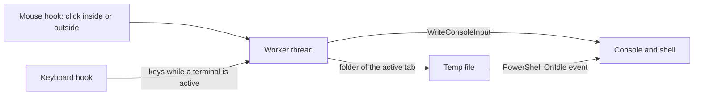

<div align="center">

<h1 align="center">
  <picture>
    <source media="(prefers-color-scheme: dark)" srcset="docs/images/banner-dark.svg">
    
  </picture>
</h1>

<p><b>Files on top, a PowerShell prompt below, same window.</b><br>Open the terminal with a hotkey, browse to another folder, and the prompt follows.</p>

[](CHANGELOG.md)

[](LICENSE)

[Install](#install) · [Usage](#usage) · [Settings](#settings) · [Security and privacy](#security-and-privacy) · [Troubleshooting](#troubleshooting) · [Changelog](CHANGELOG.md)

</div>

## At a glance

| | |
|---|---|
| **Does** | Docks a real console inside a File Explorer window and keeps it in the folder you are browsing |
| **Platform** | Windows 11, as a [Windhawk](https://windhawk.net) mod (x86-64, x86 and ARM64 builds) |
| **Shells** | Windows PowerShell (default), PowerShell 7, Command Prompt |
| **Status** | Version 0.3.2; run by the author inside Windhawk, see [Status](#status) |
| **Install** | One file, no installer, no background app |

Layout sketch (not a screenshot):

```text
┌───────────────────────────────────────────────┐
│ ← → ↑  C:\Projects\my-app                     │
│ ───────────────────────────────────────────── │
│  src/    docs/    package.json    README.md   │   File Explorer, as usual
│                                               │
├─────────────────────────── ▔▔▔ ────────── × ──┤   ← drag to resize, × to hide
│ PS C:\Projects\my-app> git status             │
│ On branch main, nothing to commit             │   a real console
│ PS C:\Projects\my-app> _                      │
└───────────────────────────────────────────────┘
```

## Why

You look at a project in Explorer, then open another window to type `git status`. This keeps both in one place: the terminal lives inside the Explorer window, shows and hides with a hotkey, and changes directory when you change folder.

## Features

| | |
|---|---|
| **Hotkey** | <kbd>Ctrl</kbd>+<kbd>J</kbd> shows or hides the terminal (F12 and <kbd>Ctrl</kbd>+<kbd>`</kbd> also available). The session keeps running while hidden; `exit` ends it. |
| **Really embedded** | A normal `conhost` console reparented into the Explorer window. Your PowerShell profile, `git`, copy and paste behave as always. |
| **Follows the folder** | Open another folder or tab and the prompt runs `cd` for you. It waits until the prompt is idle, so it never touches a line you are typing or a command that is running. PowerShell only. |
| **Typing** | Active when it opens and when you click inside it (the strip says "typing here"). Arrows, Ctrl combinations, AltGr characters and paste work. Click the file list and the keys go back to Explorer. Alt+Tab, Alt+F4, the Windows key and Ctrl+Esc are never taken. |
| **Resizable** | Drag the title strip above the terminal. The height is remembered. |
| **Your look** | Takes the color scheme and font of your Windows Terminal profile. |
| **One per window** | Each Explorer window has its own terminal. |

## Install

1. Install [Windhawk](https://windhawk.net).
2. In Windhawk choose **Create a new mod**, replace the template with the contents of [`explorer-terminal.wh.cpp`](explorer-terminal.wh.cpp), then **Compile** and **Enable**.
3. Open a File Explorer window and press **Ctrl+J**.

## Usage

| Do this | To get this |
|---|---|
| <kbd>Ctrl</kbd>+<kbd>J</kbd> in an Explorer window | Show the terminal, or hide it (the session keeps running) |
| Click inside the terminal | Send your keys to the terminal |
| Click the file list | Send your keys back to Explorer |
| Drag the strip above the terminal | Resize it |
| Click **×** on the strip | Hide it |
| Open another folder or tab | The prompt changes to that folder when it is idle |

## Settings

| Setting | Options | Default |
|---|---|---|
| Hotkey | Ctrl+J, F12, Ctrl+\` | Ctrl+J |
| Shell | Windows PowerShell, PowerShell 7 (`pwsh`), Command Prompt | Windows PowerShell |
| Look | Like your Windows Terminal, like PowerShell from the Start menu, plain console | Like your Windows Terminal |
| Terminal height | Pixels at 100% scaling. Dragging the strip overrides it until you change this value. | 260 |
| Follow the folder | On / off | On |

<details>
<summary>What the three looks do</summary>

* **Like your Windows Terminal.** Reads your Windows Terminal `settings.json` (the profile for the chosen shell, then the defaults) and applies its color scheme and font to the console. Schemes defined in your `settings.json` and Campbell are found; other built-in schemes are not bundled. If there is no `settings.json` or scheme, the next option is used.
* **Like PowerShell from the Start menu.** Uses the colors and font from the console's Properties (the classic blue by default).
* **Plain console.** Windows' default console colors.

The embedded console is the classic Windows console, so details that belong to Windows Terminal itself (text padding, the bar cursor, tabs) are not reproduced.

</details>

## How it works



<details>
<summary>Details of each piece</summary>

| Piece | Approach |
|---|---|
| Console | Start `conhost.exe powershell.exe` explicitly (a classic `ConsoleWindowClass` window, never Windows Terminal), `SetParent` it into the `CabinetWClass` window and strip its frame |
| Room for it | Subclass each `ShellTabWindowClass` and clamp its height; subclass the frame to relayout on `WM_SIZE` |
| Title strip | A small child window on Explorer's UI thread: resize handle and close button |
| Hotkey | Low-level keyboard hook on its own thread; acts only when the foreground window belongs to an Explorer window of this process |
| Typing | Windows refuses to move the keyboard focus into another process's console window (`SetFocus` fails with "access denied", measured). So the focus stays in Explorer; while a terminal is active, the keyboard hook takes the typed keys (translated with `ToUnicodeEx`, so layouts such as Turkish Q and AltGr work) and the worker writes them into the console's input buffer with `WriteConsoleInput`. A low-level mouse hook decides which side is active |
| Follow folder | The mod writes the active tab's folder (via `IShellWindows`) to a temp file; a PowerShell `OnIdle` event runs `Set-Location` and redraws the prompt when idle |
| Look | `settings.json` is read with a small JSONC reader; the palette and font are applied through the console API |

</details>

## Security and privacy

> [!NOTE]
> While a terminal is active, the mod's low-level keyboard hook sees every key you press and hands them to the terminal instead of Explorer. Nothing is stored or sent anywhere: the keys go straight into the console's input buffer. The log never contains typed keys.

What the code does, checked in the source:

* **No network.** The mod uses no network APIs.
* **Keyboard and mouse hooks.** The keyboard hook takes keys only while a terminal is active and its Explorer window is in the foreground. The mouse hook uses only the click position to decide which side is active.
* **Files it writes.** `%TEMP%\explorer-terminal.log` (events such as "terminal created" and the folder being followed; emptied when it passes about 100 KB) and one small `%TEMP%\explorer-terminal-<id>.txt` per terminal holding the current folder, deleted when the terminal ends. The terminal height is stored in Windhawk's mod settings.
* **Files it reads.** Your Windows Terminal `settings.json` (color scheme and font only), the Windows light/dark theme setting, and the Explorer window list to learn the current folder.
* **Processes it starts.** `conhost.exe` with your chosen shell, as a child of Explorer.

## Troubleshooting

The mod writes a short log to `%TEMP%\explorer-terminal.log` (also visible in Windhawk's log viewer). Include it when you report a problem.

<details>
<summary>The prompt stays in <code>C:\Windows\System32</code></summary>

Explorer is showing Home, This PC or another location that is not a folder; the terminal waits for a real folder.
</details>

<details>
<summary>Typing goes to Explorer instead of the terminal</summary>

Click inside the terminal until the strip says "typing here".
</details>

<details>
<summary>The first characters are missing</summary>

PowerShell discards input that arrives while it is still starting; wait for the prompt.
</details>

## Known limits

* Folder following needs PowerShell; with Command Prompt the terminal only starts in the current folder.
* The console is the classic one: no tabs, no Windows Terminal text padding.
* Written against the Windows 11 Explorer window layout (`CabinetWClass` > `ShellTabWindowClass`). A future Explorer update may need a fix.
* The hotkey is read by a low-level hook and only acts while an Explorer window is in the foreground.

## Status

Version 0.3.2. Run inside Windhawk by the author: embedding, resizing, hotkey, the Windows Terminal look, folder following and typing all work. Builds for all three Windhawk targets (x86-64, x86, ARM64), checked at syntax level with Windhawk's compiler.

Not yet tried with a real keyboard: AltGr layouts, Ctrl+C during a running command (sent as a key message that needs the real keyboard state) and the interplay with Explorer's own shortcuts. See [CHANGELOG.md](CHANGELOG.md) for what changed in each version.

## Development

```bash
powershell -NoProfile -File tests/run.ps1
```

`tests/run.ps1` builds `tests/self-check.cpp` with Windhawk's compiler and runs it:

* the `settings.json` reader on a realistic file;
* a color scheme applied to a hidden console, palette and font read back;
* the shell exactly as the mod starts it: typed input reaches it, and it follows a changed folder;
* the whole mod against a stand-in Explorer window: the terminal is created, the 500 ms timer keeps running, and keys posted the way the keyboard hook posts them (text, Backspace, Ctrl+C at the prompt, Enter) reach the shell.

It also lists, read-only, the folder each open Explorer window reports.

<details>
<summary>Notes for contributors</summary>

* Windhawk also builds mods for 32-bit, where a lambda does not convert to the stdcall `WNDENUMPROC`: use a named `CALLBACK` function for `EnumWindows`-style callbacks.
* `SetTimer(NULL, id, ...)` ignores `id` and returns the real timer id; keep the return value and compare `msg.wParam` with it.
* Do not call `GenerateConsoleCtrlEvent` after `AttachConsole` from a process that was started from a console: in the tests the event reached the console the process came from and ended its parent, not the attached shell.
* Check all three targets before shipping: `clang++ -fsyntax-only -target <x86_64|i686|aarch64>-w64-mingw32 ...` with Windhawk's compiler.

</details>

## License

MIT, see [LICENSE](LICENSE).
